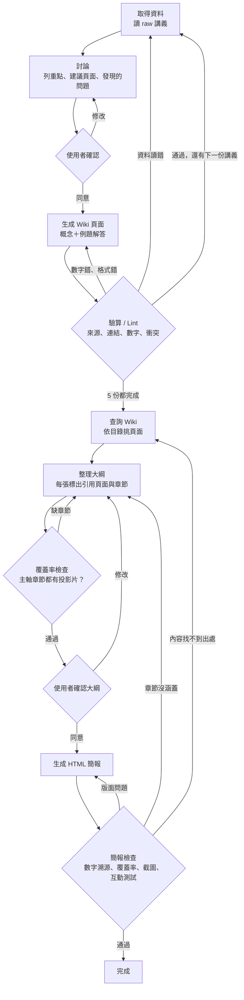

# LLM Wiki 教學簡報｜流程設計與反思

主題：高等會計學「企業合併與合併財務報表」
知識來源：5 份上課講義（Ch1–Ch5）→ 18 頁 LLM Wiki → 19 張教學 HTML 簡報
完整紀錄：見 `log.md`

---

## 一、Loop / Graph 設計（步驟三）

簡化版：**取得資料 → 討論 → 生成 Wiki → 驗算／Lint →（重複 5 次）→ 查詢 Wiki → 整理大綱 → 覆蓋率檢查 → 生成簡報 → 檢查 → 完成**

### 哪些步驟會重複執行？
| 迴圈 | 重複內容 | 實際次數 |
|---|---|---|
| Ingest 迴圈 | 每份講義跑一次「取得 → 討論 → 生成 → 驗算」 | 5 次（Ch1–Ch5） |
| 修正迴圈 | 使用者回饋或驗算失敗 → 回到生成 | Ch1 甲公司例題、巨歐例題各 1 次 |
| 簡報檢查迴圈 | 檢查不通過或使用者回饋 → 重新生成 | 4 次（① 修版面；② 使用者發現沒用到 Ch5 → 回到大綱重做；③ 使用者要求補充入門內容 → 先補 Wiki 再改簡報；④ 使用者發現分錄編號沒說明出處） |

### 哪些地方需要檢查或重新生成？
| 檢查點 | 檢查什麼 | 不通過時 |
|---|---|---|
| 討論後（人工） | 範圍、頁面切分、例題要做多深 | 回到討論 |
| 驗算 / Lint（自動＋人工） | 每頁有來源？連結有沒有斷？例題借貸平衡？用兩種方法算的答案一致嗎？講義本身有沒有錯？ | 回到生成；如果是**資料讀錯**，回到取得資料 |
| 大綱覆蓋率（自動） | 每張投影片對應哪一章？約定的主軸章節（Ch1、Ch3、Ch5）是不是每章都有投影片？ | 回到大綱 |
| 大綱確認（人工） | 初學者看得懂嗎？順序合理嗎？ | 回到大綱 |
| 簡報檢查（自動） | 簡報裡每個數字都能在 Wiki 找到嗎？各章投影片數？版面有沒有重疊？翻頁和動畫正常嗎？ | 版面問題 → 重新生成；內容找不到出處 → 回到查詢 Wiki；章節沒涵蓋 → 回到大綱 |

### 為什麼這樣設計？
1. **先討論、後生成**：先讓 AI 說出它打算怎麼整理，人確認後再寫，避免整頁寫完才發現方向錯。
2. **Wiki 是唯一的知識來源**：簡報只能引用 Wiki，每張標出引用頁面。這樣簡報的正確性可以追溯，也能用程式檢查「有沒有 Wiki 以外的內容」。
3. **錯誤越早抓越便宜**：Wiki 錯了，後面的簡報全都會錯。所以把最嚴格的檢查（驗算）放在 Wiki 階段，簡報階段只需要檢查「有沒有照抄 Wiki」和版面。

---

## 二、反思（步驟四）

### 1. 哪一個節點最常出錯？
出錯的地方分散在好幾個節點，但**最嚴重的兩次都是使用者發現的**：一次在「生成 Wiki 的例題解答」（#1），一次在「整理大綱」（#5）。另外，有一次錯誤的根源其實在最前面的「取得資料」（#2）。

| # | 節點 | 發生什麼事 | 怎麼發現的 |
|---|---|---|---|
| 1 | 生成（例題） | Ch1 甲公司例題，AI 套用了講義另一頁的一般原則，寫出兩種解法、答案差很多。但 Ch1 的例題都是基本題，出錢的一方就是收購者 | **使用者**檢查時指出 |
| 2 | 取得資料 | AI 讀講義時用指令過濾掉「只有數字的行」，結果表格的數字全部不見，把光仁、沙漠、欽富三題誤判成「講義沒給數字」 | AI 寫後面章節時回頭看排版版講義才發現 |
| 3 | 來源本身 | 講義 Ch2 安娜公司的合計數印錯（$136,000 應為 $330,000） | 驗算時用兩種方法算投資帳戶，對不上 |
| 4 | 生成（簡報） | 版面重疊 2 處 | 自動截圖檢查 |
| 5 | 整理大綱 | 大綱說主軸是 Ch1 + Ch3 + Ch5，但 AI 照講義順序排，Ch1 佔了 5 張，**Ch5 一張都沒有** | **使用者**看完簡報指出 |
| 6 | 生成（簡報） | 「常見錯誤」寫「母公司 80% 在 (1)、NCI 20% 在 (5)」，沒說 (1)、(5) 是哪裡的編號；十步驟 ①–⑩ 和五組分錄 (1)–(5) 也沒說明對應 | **使用者**指出 |

### 2. 發現問題後，把檢查往前移到哪一個步驟？
| 問題 | 原本在哪裡才發現 | 檢查往前移到 |
|---|---|---|
| #1 收購者判斷 | 使用者事後檢查 | **生成規則**：在 `CLAUDE.md` 加規則 8，生成時就照「出錢方 = 收購者」 |
| #2 數字被過濾 | 寫到後面章節才發現 | **取得資料**：加規則 9，一律讀完整排版版；表格看起來空白要回頭看 PDF |
| #3 講義錯誤 | — | **Ingest 當下就交叉驗算**（兩種方法算同一個數），不只相信來源 |
| #4 版面 | 生成後 | 維持在簡報檢查（自動截圖），成本低，不需要往前移 |
| #5 沒用到 Ch5 | 使用者看完整份簡報 | **整理大綱**：大綱要標出每張對應的章節並統計張數，主軸章節沒涵蓋就不能進入生成（CLAUDE.md 工作流程第 5 點） |
| #6 編號沒出處 | 使用者閱讀 | **簡報檢查**新增 (e)：投影片中的編號或代號要寫明出自哪一張（CLAUDE.md） |

結果：簡報的「數字溯源檢查」兩個版本都一次通過（42 個、83 個數字全部能在 Wiki 找到），代表把驗算往前移到 Wiki 階段是有效的。

但 #5 也說明：**數字全部正確，不代表簡報是對的。** 原本的檢查只問「內容有沒有出處」，沒問「該講的有沒有講到」。所以檢查項目也要往前移、往外擴：從「正確性」擴到「完整性」。#6 也是同一類問題：程式檢查得出「數字有沒有出處」，但檢查不出「讀者看不看得懂」，這部分目前仍需要人來看。

### 3. 有沒有因此修改 workflow / graph？為什麼？
有，改了五個地方：

1. **在 graph 加上「驗算失敗 → 回到取得資料」這條線**：原本以為錯誤只會發生在生成，但 #2 證明讀取資料本身也會出錯。如果只回到生成，用同樣讀錯的資料重寫，還是會錯。
2. **`CLAUDE.md` 新增規則 8、9**：把人工發現的錯誤變成規則，下一章生成時自動避免，不用每次都靠人抓。
3. **縮小例題範圍**（使用者決定）：從「每題都解」改成「每章 2 題完整、其他列考點」。全部都算太花時間，而且驗算的負擔也跟著變大。
4. **確認頻率從「每章確認」改成「Ch3–Ch5 一次確認」**（使用者決定）：速度變快，代價是 #2 的錯誤延後才發現。所以更需要規則 9 這種自動防護，取代逐章的人工確認。
5. **在 graph 的「整理大綱」後面加一個「覆蓋率檢查」節點**（#5）：大綱階段改一行字就能修正，但如果等到簡報做完才發現，要重做好幾張投影片。這次就是後者，簡報從 12 張重做成 14 張。
